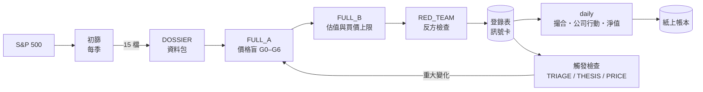

# claude-berkshire

**把波克夏式的長期選股規則，變成可排程、可稽核的紙上交易系統。**


選股規則寫成兩個 Claude Code skill：初篩與深度分析。`trader/` 框架負責排程、抓資料、調用模型、驗證輸出、記帳和報表，不改寫規則；兩者衝突時以 skill 為準。

> [!WARNING]
> 本專案**只做紙上交易**：行情來自 Alpaca paper 帳戶，成交記在本機帳本，不會對任何券商送出真實委託。系統輸出不是投資建議。改用真錢之前，每一筆 BUY 都要人工複核，並先完成前瞻紙上交易檢討。

## 目錄

- [特色](#特色)
- [運作方式](#運作方式)
- [快速開始](#快速開始)
- [使用方式](#使用方式)
- [設定](#設定)
- [專案結構](#專案結構)
- [開發](#開發)
- [安全](#安全)
- [證據與限制](#證據與限制)
- [文件](#文件)

## 特色

- **兩段式決策**：每季初篩把 S&P 500 縮成 15 檔研究名單，深度分析再逐檔決定買不買、買多少。初篩排名不能當作買進理由。
- **價格隔離**：DOSSIER、TRIAGE、THESIS、FULL_A 的沙箱看不到價格，也看不到能推回價格的數字（回購均價、增資發行價、轉換價等）。FULL_B 要在閘門 3 作答之後才開放價格檔。
- **程式算數字、模型做判斷**：買價上限、確定性等級和 G8 機會成本由 `cap_calc.py` 等腳本計算。模型給的數字跟腳本對不上時，以腳本為準並記錄落差。
- **強模型同意閘門**：FULL_A、RED_TEAM 預設要經使用者同意才執行，同意前先顯示 token 與時間估算。
- **完整紙上帳本**：撮合、公司行動（拆股、股利、改名、下市）、現金、淨值、異常與暫停、人工調整都會留紀錄。
- **可稽核**：每筆決策記錄來源、模型後端、思考強度和價格來源（`provenance`），並附決策日誌、訊號卡和完整分析報告。
- **本機儀表板**：網頁儀表板只開放 127.0.0.1，另有 macOS 桌面小工具，支援匯出 CSV、JSON、XLSX。

## 運作方式



| 階段 | 頻率 | 做什麼 |
|---|---|---|
| 初篩 `screen` | 每季（03-20、05-20、08-20、11-20） | 刪結構性垃圾、排除統計高風險、排研究順序，取前 15 檔 |
| 深度分析 `analyze` | 初篩後、或觸發時 | DOSSIER → FULL_A → FULL_B → RED_TEAM，產出 BUY／WATCH／NO_ACTION |
| 觸發檢查 `review` | 持股每天、觀察名單每兩週 | 有訊號才派模型工作，例如新申報、價格到線、失效條件到期 |
| 每日收盤 `daily` | 每個交易日收盤後 | 公司行動、撮合、觸發檢查、組合計畫、淨值 |

模型分三級，對應見 [`routing/model_routing.json`](routing/model_routing.json)：

| 等級 | 預設模型 | 工作 |
|---|---|---|
| strong | opus | FULL_A、RED_TEAM（需同意） |
| medium | sonnet | FULL_B、HOLD_REVIEW、持股 THESIS |
| weak | haiku | DOSSIER、TRIAGE、PRICE、CORP_ACTION、非持股 THESIS |

後端可選 `claude_code`（本機 `claude -p`，預設）、`openai_compat`（OpenAI 相容 API）或 `fake`（測試用）。skill 腳本本身不呼叫模型。

## 快速開始

### 需求

- Python 3.11 以上
- 已登入的 [Claude Code](https://claude.com/claude-code) CLI（`claude`）
- Alpaca 紙上交易帳戶金鑰、FRED API 金鑰
- SEC User-Agent（須包含聯絡 email）
- macOS：只有排程常駐（`scheduler install`）、桌面小工具（`desktop`）需要，這兩項使用 launchd

### 安裝

```bash
cd trader
python3 -m pip install -e ".[dev]"
cp .env.example .env        # 填入 SEC_USER_AGENT、ALPACA_API_KEY、ALPACA_SECRET_KEY、FRED_API_KEY
trader init                 # 建立 state 與資料庫，檢查設定與金鑰
trader doctor               # 測試 SEC、Alpaca、FRED、各級模型的連線（--skip-models 略過模型）
```

### 第一次建立名單

```bash
trader bootstrap --asof 2026-10-15        # 初篩＋深度分析；強模型工作會停在同意閘門
trader approvals list                     # 查看待同意工作與估算
trader approvals approve --all --run      # 同意並執行
trader dashboard                          # http://127.0.0.1:8787
```

> [!NOTE]
> 安裝排程或對現有資料執行分析之前，先讀 [`handoff.md`](handoff.md) 的現況與禁止事項。

## 使用方式

所有指令都在 `trader/` 下執行。共通參數：`--config`（預設 `TRADER_CONFIG` 或 `config.yaml`）、`--state-dir`（預設 `TRADER_STATE_DIR` 或專案根目錄的 `state/`）。日期格式 `YYYY-MM-DD`。會寫 state 的指令會先取得 `state/.pipeline.lock`；若已有另一個寫入指令在執行，就直接結束（exit 2）。

<details>
<summary><b>完整指令參考</b></summary>

| 指令 | 用途 | 常用參數 |
|---|---|---|
| `trader init` | 建立 state、資料庫，檢查設定與金鑰 | |
| `trader doctor` | 連線測試 | `--skip-models`、`--state`（只查本機 state）、`--timeout` |
| `trader fetch` | 抓 features、prices、daily、公司行動、利率 | `--asof`（必填）、`--tickers`、`--out`、`--freeze-pe`、`--refreeze` |
| `trader screen` | 季度初篩，產出交接檔到 `state/screens/{asof}/` | `--asof`、`--top 15`、`--special-max 0`、`--inputs DIR`、`--force` |
| `trader bootstrap` | 初篩＋深度分析（會呼叫模型） | `--asof`、`--tickers`（略過初篩）、`--top`、`--dry-run`、`--force`、`--mark-screened` |
| `trader analyze` | 深度分析（會呼叫模型） | `--asof`、`--tickers`、`--screen-date`、`--run-id` |
| `trader review` | 觸發檢查 | `--asof`、`--scope holdings｜watch｜all`、`--run-id`、`--due-only`（不呼叫模型） |
| `trader approvals list／approve／defer／reject` | 強模型同意閘門 | `approve ID…｜--all [--run]`；`reject ID… --note` |
| `trader run-approved` | 執行已同意的強模型工作 | `--run-id` |
| `trader daily` | 每日收盤流程 | `--date`（必填）、`--dry-run`、`--skip-review`、`--force` |
| `trader jobs list／retry／resume／abandon` | 工作管理（retry、resume 會呼叫模型） | `--run-id`、`--ticker`、`--job-id`、`--no-run` |
| `trader ledger show／adjust／cancel／pause` | 紙上帳本 | `adjust --note`（必填）＋`--cash`／`--deposit`／`--ticker --qty --avg-cost`／`--unpause T`／`--unpause-all`／`--resolve ID`；`pause [T｜--all] --note` |
| `trader trade buy／sell` | 人工下單，下一次 daily 撮合 | `--ticker --qty --note`；buy 必填 `--limit` |
| `trader decisions void` | 作廢錯誤決策（不刪除資料列） | `ID… --note`、`--superseded-by` |
| `trader registry retire` | 登錄表標下市或不再追蹤 | `T --note` |
| `trader db backup` | 資料庫快照到 `state/backups/` | `--note` |
| `trader dashboard` | 本機儀表板 | `--port`（預設 8787） |
| `trader desktop build／install／uninstall／status` | macOS 小工具與開機自動啟動 | `install --port --no-widget` |
| `trader scheduler run／once／install／uninstall／status／reset／print` | 常駐排程 | `run --interval`、`reset [任務鍵]`、`print --cron` |
| `trader export` | 匯出持股、交易、分析、淨值等 | `--what all｜清單`、`--format csv｜json｜xlsx`、`--out` |
| `trader validate-report` | 前瞻紙上交易檢討 | `--start`、`--end`、`--no-prices`、`--out` |
| `trader run-job` | 單一工作，除錯用 | `JOB_TYPE TICKER --asof [--fake DIR]` |

</details>

## 設定

| 檔案 | 內容 |
|---|---|
| [`trader/config.yaml`](trader/config.yaml) | 主要設定，只寫環境變數名稱，不放金鑰。各欄位說明見 [`config.example.yaml`](trader/config.example.yaml) |
| `trader/.env` | 金鑰，範本是 [`.env.example`](trader/.env.example)。不進版本控制 |
| `state/`（選填） | 使用者輸入檔：`universe_override.txt`（自訂股票池）、`exclusions.csv`（人工排除）、`screen_overrides.csv`（撤銷結構性刪除）、`cik_predecessors.json`、`share_class_ratios.csv`。沒有這些檔就用預設值 |

`config.yaml` 主要區塊：

- `account`：初始資金、滑價、手續費、現金緩衝、單檔硬上限、基準（SPY）
- `schedule`：時區、收盤時間、觀察名單檢查間隔、季度初篩日、每月 P/E 中位凍結日
- `models.strong／medium／weak`：後端、模型、`effort`、逾時、併發數
- `budget`：每次 run 與每日的模型呼叫數、費用、token 上限（0 表示不限）
- `data`：SEC、Alpaca、FRED 金鑰的環境變數名稱，Alpaca feed，研究取價來源
- `valuation.cap_discount_k`：自動買進上限 = 0.95 × min(P2′, k × IV_base)，預設 k：A 級 0.95、B 級 0.85
- `dashboard`：host（只限 127.0.0.1）、port

## 專案結構

```
.
├── berkshire-screen-merged/     # 初篩 skill
│   ├── SKILL.md
│   ├── references/              # 實證依據、資料來源
│   └── scripts/                 # fetch_edgar、fetch_prices、screen、screen_quant、test_screen
├── berkshire-deep-merged/       # 深度分析 skill
│   ├── SKILL.md
│   ├── references/              # rulebook、procedure/、rule_index/、knowledge/、inferred_thresholds
│   ├── assets/                  # 閘門 3 問卷、訊號卡／登錄表／決策日誌 schema、報告範本
│   └── scripts/                 # build_dossier、cap_calc、gate3_check、deep_quant、review_due
├── routing/                     # 工作 → 模型等級、提示、輸出格式
│   ├── model_routing.json
│   ├── output_schemas.json
│   └── prompts/
├── trader/                      # 執行框架
│   ├── trader/
│   │   ├── data/                # SEC、Alpaca、Yahoo、FRED、股票池、P/E 中位
│   │   ├── analysis/            # 資料包、同業、內部人、檢查、回寫
│   │   ├── jobs/                # 工作引擎、沙箱隔離、輸出驗證、同意閘門
│   │   ├── llm/                 # 模型後端
│   │   ├── pipelines/           # screen、analyze、review、daily、bootstrap
│   │   ├── portfolio/           # 部位、G8 比較、相關群
│   │   ├── ledger/              # 帳本、撮合、公司行動
│   │   ├── report/              # 指標、匯出、檢討
│   │   ├── dashboard/  web/     # 儀表板 API 與網頁
│   │   ├── scheduler.py
│   │   └── cli.py
│   ├── tests/
│   ├── desktop/                 # macOS 小工具（Swift）
│   └── CONTRACTS*.md            # 各里程碑介面契約
├── docs/archive/                # 歷史交接紀錄
├── bug report/                  # 歷次審查報告與重現腳本
├── handoff.md                   # 現況與待辦
├── plan.md  plan_dashboard.md   # 規劃
└── 換機匯出與封存程序.md
```

執行期資料都寫在 `state/`（資料庫、SEC 快取、分析結果、價格、報告），不進版本控制。

## 開發

```bash
cd trader && python3 -m pytest -q                          # trader 全套，約 3–5 分鐘
python3 berkshire-screen-merged/scripts/test_screen.py      # 初篩自測（在專案根目錄執行）
python3 berkshire-deep-merged/scripts/test_review_due.py    # 觸發檢查自測
```

目前結果（2026-10-21，A 機）：3205 passed、2 failed、4 skipped。這 2 個失敗是環境差異造成的：

- `test_fix_P35`：需要 B 機專用的 `hark/` 工具，這個工具刻意不放進 repo。
- `test_fix_RM1_5`：讀取本機 `state/` 的凍結 P/E 檔，內容跟 B 機不同。

慣例：

- 修 bug 先寫會失敗的測試，再修程式。修復測試檔命名為 `tests/test_fix_<編號>.py`。
- 改動規則或門檻時，要同時更新 skill 文件。推論出來、未經回測的參數記在 `inferred_thresholds.md`。
- `handoff.md` 只寫現況，每次 session 結束時整份覆寫，歷史移到 `docs/archive/`。

## 安全

- **金鑰**只放 `trader/.env` 或環境變數，程式和設定檔不得寫死金鑰或 email。呼叫模型的子程序會剔除秘密環境變數。
- **模型沙箱**：`claude -p` 不載入使用者層設定與 MCP，以 `disableAllHooks` 停用 hooks，每次呼叫前清除沙箱內的 `.claude/`，只開放 Read／Write／Glob／Grep，禁止 Bash 與網路工具。
- **不得提交**：`trader/.env`、`state/`（含 `trader.db`）、`test_runs/`、匯出與修補產物。`.gitignore` 已經擋掉這些，提交前仍要確認。
- **儀表板**只聽本機。同意等寫入 API 需要 `state/.dashboard_token`（權限 600），並檢查 Host 與 Origin。

## 證據與限制

- **有證據的**：初篩能降低踩雷。3 年內大跌的機率下降，被刪除的股票出現壞結果的比例約為留下者的 3 倍。
- **沒有證據的**：排名能提高報酬（逐期模擬不顯著），以及整條流程的報酬（深度分析靠判斷，無法完整回測）。
- 自訂參數（自動買進上限的 k、困境特殊情境、觸發門檻等）都標為推論、未經回測，見 [`inferred_thresholds.md`](berkshire-deep-merged/references/inferred_thresholds.md)。
- 證據來自美國大型股，其他市場和小型股未驗證。S&P 500 用的是現有成分股，有存活者偏差，只影響回測。
- 深度分析需要年報文字、附註和委託書。只有數字時，正確結論是 `MISSING_DATA`。
- 多類股公司可能停報封面合計股數，此時改用 XBRL 推算，市值可能略有誤差，報告會標示。

## 文件

| 文件 | 內容 |
|---|---|
| [`handoff.md`](handoff.md) | 現況、禁止事項、下一步、仍有效的決策（新 session 先讀） |
| [`plan.md`](plan.md)、[`plan_dashboard.md`](plan_dashboard.md) | 整體規劃、儀表板規劃 |
| [`trader/CONTRACTS*.md`](trader/CONTRACTS.md) | 資料庫、CLI、各里程碑的介面契約 |
| [`routing/README.md`](routing/README.md) | 工作路由、提示、輸出格式 |
| [`換機匯出與封存程序.md`](換機匯出與封存程序.md) | 換機重跑、匯出、封存、還原、作廢重跑 |
| [`docs/archive/`](docs/archive/) | 歷史交接紀錄：各輪修復清單、設計決策 D1–D99、實測紀錄 |
| [`bug report/`](bug%20report/) | 歷次審查報告 |
